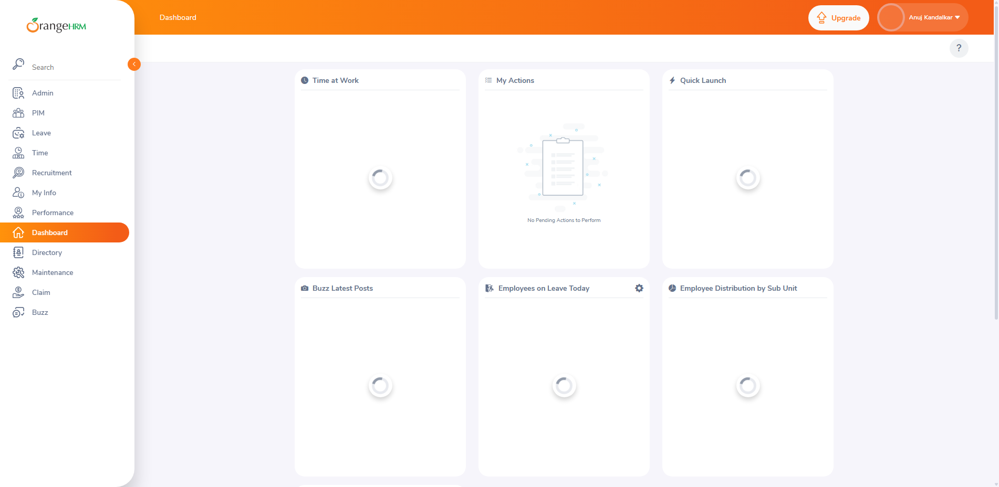
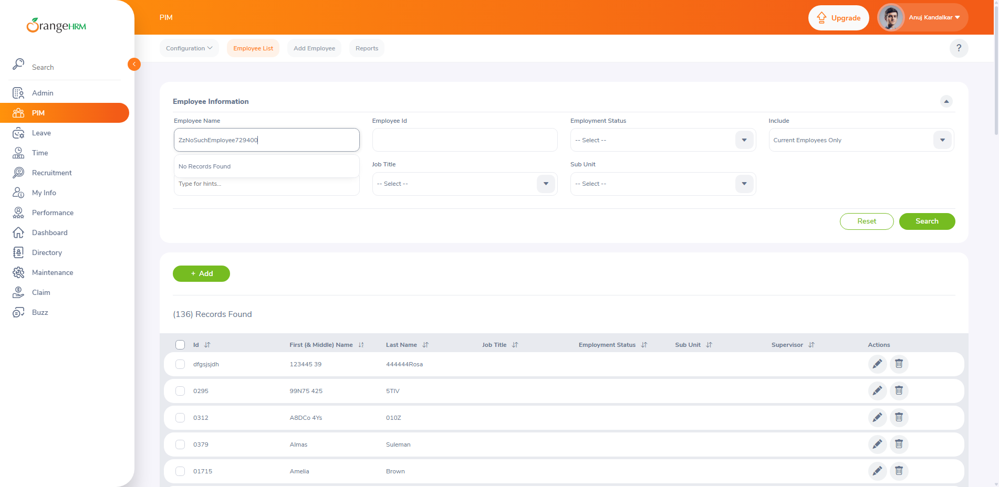
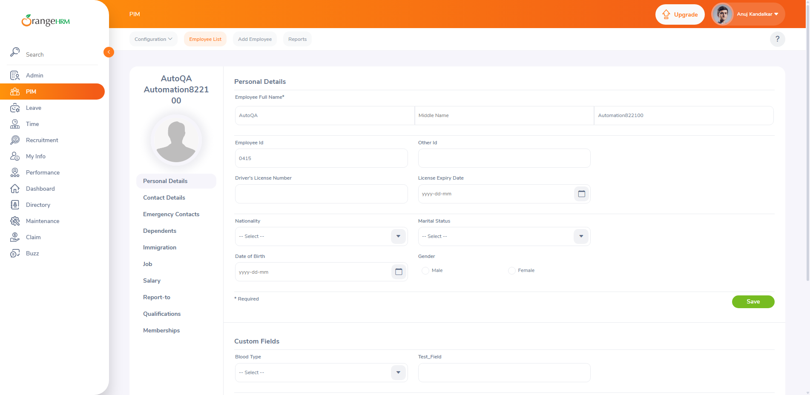
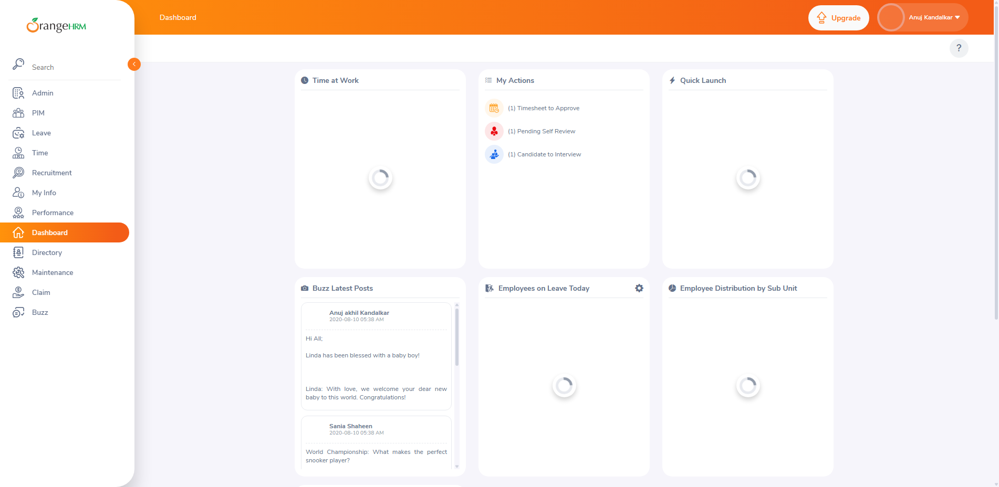

# OrangeHRM Automation Testing Graduation Project

End-to-end test automation for the [OrangeHRM Open Source Demo](https://opensource-demo.orangehrmlive.com/) built with **Java, Selenium WebDriver, TestNG, and the Page Object Model**. The suite covers the 11 required graduation-project scenarios, runs the TestNG classes in parallel, and publishes Allure reports with screenshots and environment details.

**Final verification (16 Nov 2026):** `Tests run: 11, Failures: 0, Errors: 0, Skipped: 0` — **BUILD SUCCESS**.

---

## 1. Project Overview

| Item | Details |
|---|---|
| Application under test | OrangeHRM Open Source Demo 5.9 |
| Base URL | `https://opensource-demo.orangehrmlive.com/web/index.php` |
| Test framework | TestNG 7.12.0 with Page Object Model |
| Browser | Google Chrome (headless by default), managed by Selenium Manager |
| Execution mode | `parallel="tests"`, `thread-count="2"` |
| Test data | JSON files loaded with Gson and injected through TestNG `DataProvider` |
| Reporting | Allure TestNG 2.35.6 + committed static HTML report |
| Logging | Log4j2 (console + `logs/automation.log`) |
| Retry policy | `IRetryAnalyzer`, maximum 2 retries per failed test |
| Total scenarios | 11 (all passing in the final run) |

The project demonstrates reusable page objects, explicit-wait synchronization, thread-safe driver management, data-driven testing, meaningful assertions at every verification point, and evidence collection through Allure and screenshots.

---

## 2. Technology Stack

| Technology | Version | Purpose |
|---|---|---|
| Java | 17+ (project target: 17) | Language and runtime |
| Selenium WebDriver | 4.52.0 | Browser automation |
| TestNG | 7.12.0 | Test runner, assertions, DataProviders, parallel execution |
| Maven | 3.9.11 | Build and dependency management |
| Gson | 2.15.0 | JSON test-data deserialization |
| Allure TestNG | 2.35.6 | Steps, attachments, environment and HTML report |
| Log4j2 | 2.26.1 | Execution logging |
| Google Chrome | 157 (final run) | Browser under test |

---

## 3. Framework Design

- **Page Object Model** — each OrangeHRM screen has a dedicated page class (`LoginPage`, `DashboardPage`, `PimEmployeeListPage`, `AddEmployeePage`, `PersonalDetailsPage`, `SystemUsersPage`, `AddUserPage`). Shared page behavior lives in `BasePage`; reusable UI areas live in `FooterComponent` and `SidebarComponent`.
- **Thread-safe parallel execution** — `DriverManager` stores one `WebDriver` per thread in a `ThreadLocal<WebDriver>`. `BaseTest` creates a fresh browser before each test method and quits it afterwards, so parallel classes never share a session.
- **Explicit waits only** — `BasePage` uses `WebDriverWait` with a 15-second timeout and sets the implicit wait to zero. There is no `Thread.sleep()` anywhere in the project.
- **Data-driven tests** — login and employee data are stored in JSON, parsed with Gson, and supplied by TestNG `DataProvider` methods. Test methods contain no hardcoded credentials or employee values.
- **Stable interactions** — `BasePage.click()` retries clicks intercepted by OrangeHRM's loading overlays, and waits for both the page spinner and form loader to disappear.
- **Allure reporting** — every test is wrapped in meaningful steps, key screenshots are attached to steps, and `BaseTest` attaches a post-test screenshot (plus page source on failure). Allure environment data records browser, URL, headless mode, wait timeout, OS, Java version, and parallel mode.
- **Logging** — Log4j2 logs test lifecycle, navigation, interactions, screenshots, and failures. Passwords are never written to logs or Allure parameters (`[REDACTED]`).
- **Retry analyzer** — `RetryAnalyzer` retries a failed test up to two times to absorb transient public-demo/network issues.

---

## 4. Project Structure

```text
automation-testing-graduation-project/
├── pom.xml
├── testng.xml
├── README.md
├── .gitignore
├── .gitattributes
├── allure-report/                 # Generated static Allure HTML report (committed)
├── evidence/
│   ├── execution-summary.txt      # Final execution statistics
│   ├── execution.log              # Final Log4j2 execution log
│   ├── allure-summary.json        # Allure statistics
│   └── screenshots/               # Numbered UI evidence for TC01–TC11
├── src/
│   ├── main/java/com/orangehrm/
│   │   ├── components/            # FooterComponent, SidebarComponent
│   │   ├── config/                # ConfigReader
│   │   ├── driver/                # DriverManager (ThreadLocal)
│   │   ├── models/                # JSON model records
│   │   └── pages/                 # Page Objects + BasePage
│   └── test/
│       ├── java/com/orangehrm/
│       │   ├── data/              # TestDataProvider
│       │   ├── listeners/         # TestListener, RetryAnalyzer
│       │   ├── tests/             # BaseTest + 3 test classes
│       │   └── utils/             # ScreenshotUtils
│       └── resources/
│           ├── config.properties
│           ├── allure.properties
│           ├── log4j2.xml
│           └── testdata/
│               ├── login-data.json
│               └── employee-data.json
└── target/                        # Generated at runtime, not committed
```

`target/`, `allure-results/`, and `logs/` are intentionally excluded from version control. Only the generated `allure-report/` is committed, as required.

---

## 5. Test Scenarios and Actual Results

All 11 scenarios passed in the final parallel run. Evidence screenshots are linked in the last column.

| ID | Scenario | Test method | Expected result | Actual result | Evidence |
|---|---|---|---|---|---|
| TC01 | Login with valid credentials | `LoginTests.loginWithValidCredentials` | Dashboard opens with the `Dashboard` header and `/dashboard/index` URL | **Passed** — dashboard header and URL verified | [Screenshot](evidence/screenshots/TC01_login_valid_dashboard.png) |
| TC02 | Login with invalid credentials | `LoginTests.loginWithInvalidCredentials` | `Invalid credentials` alert is shown and the user stays on the login page | **Passed** — alert text and `/auth/login` URL verified | [Screenshot](evidence/screenshots/TC02_login_invalid_credentials_error.png) |
| TC03 | Login with empty fields | `LoginTests.loginWithEmptyFields` | Two `Required` validation messages appear, one per field | **Passed** — both messages and their field association verified | [Screenshot](evidence/screenshots/TC03_login_empty_required_validation.png) |
| TC04 | Search for an existing employee | `EmployeeManagementTests.searchForExistingEmployee` | Known employee appears in the PIM results table | **Passed** — `Amelia Brown` found in the results table | [Screenshot](evidence/screenshots/TC04_existing_employee_search_result.png) |
| TC05 | Search for a non-existing employee | `EmployeeManagementTests.searchForNonExistingEmployee` | No matching employee is returned | **Passed** — `No Records Found` shown; random name absent after Search | [Screenshot](evidence/screenshots/TC05_non_existing_employee_no_records.png) |
| TC06 | Open the Add Employee page | `EmployeeManagementTests.openAddEmployeePage` | `/pim/addEmployee` opens with First Name and Last Name fields | **Passed** — URL and both fields verified | [Screenshot](evidence/screenshots/TC06_add_employee_page.png) |
| TC07 | Add employee with First Name empty | `EmployeeManagementTests.addEmployeeWithEmptyFirstName` | `Required` validation appears under First Name; employee is not created | **Passed** — validation message shown, URL remains on Add Employee | [Screenshot](evidence/screenshots/TC07_add_employee_first_name_required.png) |
| TC08 | End-to-end add employee | `EmployeeManagementTests.addEmployeeEndToEnd` | Employee is created, Personal Details match, and the employee appears in Employee List | **Passed** — unique employee created, details matched, search result verified | [Personal Details](evidence/screenshots/TC08_new_employee_personal_details.png), [Search result](evidence/screenshots/TC08_new_employee_search_result.png) |
| TC09 | Verify Admin > Add User page | `AdminNavigationTests.verifyAddUserPage` | `User Role`, `Employee Name`, `Username`, and `Password` fields are present | **Passed** — form URL, labels, and inputs verified | [Screenshot](evidence/screenshots/TC09_admin_add_user_form.png) |
| TC10 | Verify footer branding link | `AdminNavigationTests.verifyFooterBrandingLink` | Footer contains `OrangeHRM, Inc`; link opens `orangehrm.com` in a new tab | **Passed** — branding text, link, new tab, and URL verified | [Footer](evidence/screenshots/TC10_footer_branding.png), [New tab](evidence/screenshots/TC10_footer_link_new_tab.png) |
| TC11 | Verify the sidebar menu UI | `AdminNavigationTests.verifySidebarMenu` | Sidebar contains the nine required modules in order | **Passed** — all required items found in the expected order | [Screenshot](evidence/screenshots/TC11_sidebar_menu.png) |

### Note on TC05 (actual OrangeHRM 5.9 behavior)

OrangeHRM 5.9 shows the **`No Records Found`** message inside the Employee Name autocomplete while typing an unknown name, before the Search button is clicked. The test reflects the real UI behavior:

1. Enters a randomly generated non-existing name.
2. Asserts that `No Records Found` is visible and captures a screenshot.
3. Clicks **Search**.
4. Verifies that the random name does not appear in the results table and that the user remains on `/pim/viewEmployeeList`.

---

## 6. Test Data

| File | Contents |
|---|---|
| `src/test/resources/testdata/login-data.json` | Valid, invalid, and empty login scenarios, including expected URL and message |
| `src/test/resources/testdata/employee-data.json` | Existing employee (`Amelia Brown`), non-existing seed, and new-employee name |

- `TestDataProvider` reads both files once with Gson and exposes them through TestNG DataProviders.
- Login test methods receive a `LoginScenario` object; employee tests receive an `EmployeeData` object.
- The new employee's last name and the non-existing search name receive a unique numeric suffix at runtime, preventing collisions on the shared public demo.
- The demo's existing employee (`Amelia Brown`) may change if OrangeHRM resets its public dataset; update `employee-data.json` if needed.

> The repository contains only the public OrangeHRM demo account supplied with the assignment. No private credentials, tokens, or secrets are committed. Password values are masked in logs and Allure parameters.

---

## 7. Configuration

Settings live in `src/test/resources/config.properties`:

| Property | Default | Description |
|---|---|---|
| `base.url` | `https://opensource-demo.orangehrmlive.com/web/index.php` | Application base URL |
| `login.path` | `/auth/login` | Login page path |
| `browser` | `chrome` | Browser name (Chrome is supported) |
| `headless` | `true` | Run Chrome without a visible window |
| `explicit.wait` | `15` | Explicit wait timeout in seconds |
| `page.load.timeout` | `60` | Page load timeout in seconds |
| `screenshot.dir` | `target/screenshots` | Runtime screenshot output directory |

Any value can be overridden with a JVM system property without editing the file:

```bash
mvn clean test -Dheadless=false
mvn clean test -Dexplicit.wait=20
```

---

## 8. Prerequisites

- **JDK 17 or newer** (`java -version`)
- **Maven 3.9+** (`mvn -version`)
- **Google Chrome** installed
- Internet access to the public OrangeHRM demo
- Optional: **Allure Commandline 2.24+** to regenerate/open the report locally

Selenium Manager, bundled with Selenium 4, automatically resolves the matching ChromeDriver. No manual driver download or `webdriver.chrome.driver` configuration is required.

---

## 9. Installation and Execution

Clone the repository and run the suite:

```bash
git clone https://github.com/almasrii19/automation-testing-graduation-project.git
cd automation-testing-graduation-project
mvn clean test
```

The Maven build compiles the project, runs `testng.xml`, and writes:

- TestNG/Surefire results to `target/surefire-reports/`
- Screenshots to `target/screenshots/`
- Allure raw results to `allure-results/`
- Logs to `logs/automation.log`

### Parallel execution

`testng.xml` defines three `<test>` groups (Authentication, PIM Employee, Admin and Navigation) with:

```xml
<suite name="OrangeHRM Automation Suite" parallel="tests" thread-count="2">
```

TestNG runs the groups in two threads. Each thread creates its own Chrome session through `DriverManager`'s `ThreadLocal<WebDriver>`, so there is no shared browser state. The thread count is kept at 2 because the public demo becomes slower under heavier parallel load; it can be increased in `testng.xml` if the environment allows it.

---

## 10. Reports and Evidence

### Allure report

A complete static report is committed at:

```text
allure-report/index.html
```

Open that file in a browser to view the report. To regenerate it from a fresh run:

```bash
mvn clean test
allure generate allure-results --clean -o allure-report
allure open allure-report
```

Alternatively, use `allure serve allure-results` to generate and open a temporary report.

The report contains:

- 11 passed tests grouped by epic, feature, and story
- Step-by-step execution details with timings
- Screenshots attached to key steps and to each test teardown
- Environment panel: browser, base URL, headless mode, explicit wait, OS, Java version, parallel mode

### Execution evidence

| Evidence | Location |
|---|---|
| Final execution summary | [`evidence/execution-summary.txt`](evidence/execution-summary.txt) |
| Final Log4j2 log | [`evidence/execution.log`](evidence/execution.log) |
| Allure statistics | [`evidence/allure-summary.json`](evidence/allure-summary.json) |
| UI screenshots for all test cases | [`evidence/screenshots/`](evidence/screenshots/) |

### Execution gallery

| Valid login (TC01) | Non-existing employee (TC05) |
|---|---|
|  |  |

| New employee details (TC08) | Sidebar menu (TC11) |
|---|---|
|  |  |

Logs and screenshots are regenerated on every run. `allure-results/` and `logs/` remain untracked; the committed `evidence/` copies and `allure-report/` preserve the verified final run.

---

## 11. Final Actual Results

| Metric | Value |
|---|---|
| Execution date | 16 November 2026 |
| Command | `mvn -B clean test` |
| Environment | Windows 11, Java 26.0.2.1, Chrome 157 (headless), Maven 3.9.11 |
| Execution mode | TestNG `parallel="tests"`, `thread-count="2"` |
| Tests run | **11** |
| Passed | **11** |
| Failed | **0** |
| Errors | **0** |
| Skipped | **0** |
| Surefire suite time | **51.22 s** |
| Total Maven build time | **53.304 s** |
| Build status | **BUILD SUCCESS** |
| Retries triggered | 0 |
| Allure report | **11 passed, 0 failed, 0 broken, 0 skipped** |

These values are taken from the final run's Surefire output, Log4j2 log, and Allure `summary.json`; no results are estimated or fabricated.

---

## 12. Implementation Notes and Limitations

- **Explicit waits only** — `Thread.sleep()` is not used. Waits are centralized in `BasePage` and tied to concrete UI conditions (URL, visibility, text, overlays).
- **Public demo stability** — the shared OrangeHRM demo can be slow or reset. The suite uses 15-second explicit waits, overlay-aware clicks, unique employee names, and a two-attempt retry analyzer.
- **Created records are real** — TC08 creates an employee on the public demo with a unique last name. This is intentional for end-to-end verification and does not affect other runs.
- **Chrome only** — `DriverManager` currently supports Chrome, which is the browser configured for this assignment. Supporting another browser would require adding the corresponding WebDriver options.
- **Allure report viewing** — GitHub does not render `index.html` directly from the repository. Clone/download the project and open `allure-report/index.html`, or regenerate/serve it with the Allure CLI.

---

## 13. Author

**Hosny Almasrii** — [GitHub @almasrii19](https://github.com/almasrii19)

This project was developed for the automation-testing graduation assignment.
